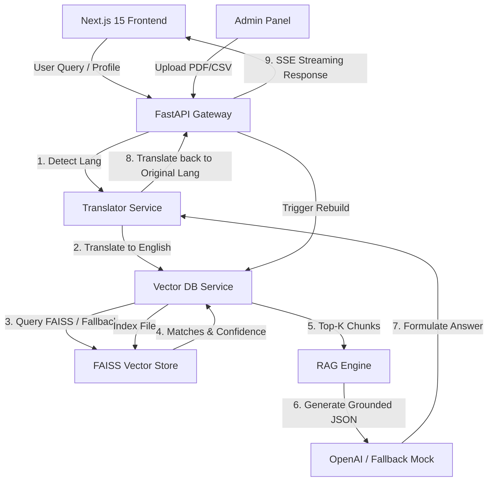

# GovAssist AI - Citizen Welfare Schemes Retrieval & Application Assistant

GovAssist AI is an enterprise-grade, production-ready web application built to help Indian citizens discover, understand, and apply for government welfare schemes. Using Retrieval-Augmented Generation (RAG), the application answers queries in 11 Indian languages, grounds all suggestions in official PDF guidelines/datasets, evaluates eligibility, and provides step-by-step next-actions checklists.

---

## Architecture Diagram



---

## Folder Structure

```
/ (Workspace Root)
├── backend/
│   ├── app/
│   │   ├── api/
│   │   │   ├── auth.py          # JWT user signups & logins
│   │   │   ├── chat.py          # SSE streaming chatbot
│   │   │   ├── search.py        # Semantic scheme search
│   │   │   ├── eligibility.py   # Eligibility checks
│   │   │   ├── documents.py     # PDF & CSV ingestion
│   │   │   ├── feedback.py      # Upvotes/downvotes rating
│   │   │   ├── analytics.py     # Usage stats
│   │   │   ├── history.py       # Conversational sessions management
│   │   │   └── pdf.py           # ReportLab PDF attachment export
│   │   ├── core/
│   │   │   ├── config.py        # Configuration schemas
│   │   │   ├── security.py      # JWT & bcrypt security
│   │   │   └── database.py      # SQLAlchemy DB configurations
│   │   ├── models/
│   │   │   └── models.py        # DB schemas (User, Message, Feedback...)
│   │   ├── schemas/
│   │   │   ├── auth.py, chat.py, eligibility.py, admin.py
│   │   └── services/
│   │       ├── vector_db.py     # FAISS + pure Python indexer
│   │       ├── rag.py           # RAG orchestrator
│   │       ├── translator.py    # Multi-language translation router
│   │       ├── eligibility_engine.py # Profile condition checks
│   │       └── pdf_exporter.py  # ReportLab layout compiler
│   ├── documents/               # Folder for source PDFs
│   ├── datasets/                # Folder for scheme CSVs
│   ├── vector_db/               # Serialized FAISS indices
│   ├── requirements.txt         # Backend Python packages
│   └── tests/
│       └── run_tests.py         # Automated verification tests
├── frontend/
│   ├── src/
│   │   ├── app/
│   │   │   ├── page.tsx         # Hero Landing Page
│   │   │   ├── login/           # SignIn view
│   │   │   ├── register/        # SignUp view
│   │   │   ├── dashboard/       # Citizen workspace layout
│   │   │   │   ├── page.tsx     # Unified Chat & Policy Path workspace
│   │   │   │   └── search/      # Semantic search portal
│   │   │   ├── admin/           # Admin file uploads & telemetry console
│   │   │   ├── layout.tsx       # Root layout
│   │   │   └── providers.tsx    # React Query caching context
│   │   ├── components/
│   │   │   └── Dashboard/
│   │   │       ├── Sidebar.tsx, ChatWindow.tsx, PolicyPath.tsx, ProofBox.tsx, EligibilityForm.tsx
│   │   ├── store/
│   │   │   └── useAppStore.ts   # Zustand state store
│   │   └── services/
│   │       └── api.ts           # Axios client configurations
├── .env.example                 # Environment variables template
└── README.md                    # System Documentation
```

---

## Installation & Setup Guide

### Prerequisites
- **Node.js**: v18.0.0 or higher
- **npm**: v9.0.0 or higher
- **Python**: v3.10 or higher
- **C++ Build Tools**: Required for compiled packages (like FAISS / numpy) if pre-built wheels are not resolved (though the backend implements an automatic pure-Python search fallback if imports fail).

### 1. Backend Setup
1. Open a terminal and navigate to the `backend` folder:
   ```bash
   cd backend
   ```
2. Create a virtual environment:
   ```bash
   python -m venv .venv
   ```
3. Activate the virtual environment:
   - **Windows (PowerShell)**:
     ```powershell
     .venv\Scripts\Activate.ps1
     ```
   - **macOS / Linux**:
     ```bash
     source .venv/bin/activate
     ```
4. Install python dependencies:
   ```bash
   pip install -r requirements.txt
   ```
5. Copy `.env.example` from the project root into a new file named `backend/.env` (or set environment variables):
   ```bash
   cp ../.env.example .env
   ```
6. Start the FastAPI backend server:
   ```bash
   uvicorn app.main:app --reload --port 8000
   ```

### 2. Frontend Setup
1. Open a new terminal and navigate to the `frontend` folder:
   ```bash
   cd frontend
   ```
2. Install Node packages:
   ```bash
   npm install
   ```
3. Start the Next.js development server:
   ```bash
   npm run dev
   ```
4. Open your browser and navigate to `http://localhost:3000`.

---

## Environment Variables Configuration

The application reads configurations from environment variables or a `.env` file placed inside `backend/` folder.

| Parameter | Description | Default / Example |
| :--- | :--- | :--- |
| `PORT` | FastAPI web server port | `8000` |
| `HOST` | FastAPI binding host | `0.0.0.0` |
| `DATABASE_URL` | SQLAlchemy database link | `sqlite:///./govassist.db` |
| `JWT_SECRET` | Secret key for encoding JWTs | `super_secret_jwt_key_change_me` |
| `OPENAI_API_KEY` | OpenAI API Key (leave empty for mock mode) | `sk-proj-...` |
| `MODEL_NAME` | Grounding LLM model name | `gpt-4o-mini` |
| `EMBEDDING_MODEL_NAME` | Local Sentence-Transformer model | `all-MiniLM-L6-v2` |
| `PDF_FOLDER` | Upload path for PDF documents | `backend/documents` |
| `DATASET_FOLDER` | Upload path for CSV files | `backend/datasets` |
| `VECTOR_DB_PATH` | Path to save FAISS files | `backend/vector_db` |

---

## API Routes Documentation

### Authentication
- `POST /api/auth/register`: Create a new citizen account.
- `POST /api/auth/login-json`: Exchange email/password for access/refresh tokens.
- `POST /api/auth/refresh`: Refresh expired JWT tokens.
- `GET /api/auth/me`: Get active profile details.

### Chatbot
- `POST /api/chat/send`: Post a query. Returns an SSE stream yielding response words, message IDs, citations, and action plans.

### Search
- `GET /api/search/`: Perform semantic vector search over schemes.
- `GET /api/search/suggestions`: Returns trending search suggest items.

### Eligibility
- `POST /api/eligibility/check`: Analyzes age, income, and state metrics against target schemes.

### Documents & Admin
- `GET /api/documents`: List active guideline documents.
- `POST /api/documents/upload`: Ingest new PDF/CSV files.
- `DELETE /api/documents/{id}`: Delete guidelines.
- `GET /api/analytics/summary`: Fetch telemetry stats.
- `POST /api/feedback/`: Send thumbs-up/down feedback.
- `GET /api/pdf-export/export/{message_id}`: Compiles and downloads ReportLab PDF reports.

---

## Troubleshooting Guide

### 1. Windows Execution Policy Errors
If PowerShell blocks activating the virtual environment or running npm:
```powershell
Set-ExecutionPolicy -ExecutionPolicy Bypass -Scope Process
```
Or run npm commands via cmd.exe explicitly, e.g. `npm.cmd`.

### 2. Model Weight Downloads
On the first start, the system downloads `all-MiniLM-L6-v2` model weights (approx 90MB) from the Hugging Face Hub. If you see it hanging, check your internet connectivity. The weights are cached locally and subsequent boots will start instantly.

### 3. Missing OpenAI API Key
If no `OPENAI_API_KEY` is provided, GovAssist AI automatically engages a smart, high-fidelity local generator. Chat search and eligibility evaluations remain 100% operational using FAISS grounding. Swapping in a valid key enables advanced generative reasoning.
